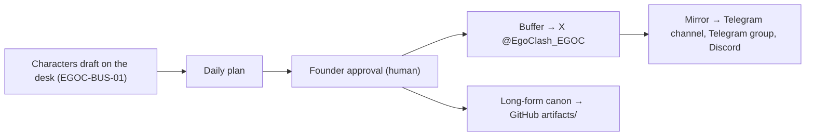

<p align="center">
  
</p>

# EGOCLASH (`$EGOC`) — PROTOCOL WHITEPAPER v2.1
### *Six Voices, One Desk, One Bonding Curve — and Only the Claims the Chain Can Prove*

[](./WHITEPAPER.md)
[](./WHITEPAPER.md)
[](https://solscan.io/token/BrfMCtwXY7tLvgmPD2wFk55ckvFms2MVNrzu1yZBpump)
[](https://pump.fun/coin/BrfMCtwXY7tLvgmPD2wFk55ckvFms2MVNrzu1yZBpump)
[](https://github.com/egoclash-protocol/egoclash-ai-engine/tree/main/artifacts)

---

## Changelog (v2.0 → v2.1, 12/11/2026)

- **Removed** the "Solana & Base (ERC-20)" dual-network claim. Only the Solana SPL token exists on-chain; `contracts/EgoClashERC20.sol` is reference source code, not a deployed token.
- **Corrected** supply: the initial supply was 1,000,000,000; the current on-chain supply is lower because tokens have been burned (Section 7).
- **Clarified** liquidity status: as of 12/11/2026 the pump.fun bonding curve is **not complete**, so there is no PumpSwap pool yet. Graduation is described as a mechanism, not a date or a promise.
- **Added** the Jupiter Lock details read directly from the lock account (unlock 30/06/2027).
- **Added** THE TERMINAL and STRAY_CATD to the cast, so it matches the six voices that post today.
- **Added** the website, the Telegram community group, Discord, and how publishing actually works (founder approval → Buffer → X, mirrored to Telegram and Discord).
- **Added** the EGOCLASH Badges NFT collection on Crossmint.
- **Renamed** Chad's series to *The EGOCLASH Chronicles* (files `artifacts/the_egoclash_chronicles_ch*.md`).
- **Removed** unverifiable engineering claims: the named fallback model list, "guaranteed 24/7 uptime", per-character X handles, and the MiCA "compliance" statement (replaced with a plain disclaimer).
- **Updated** the artifacts catalogue (adds Incident Report #001, The Reflexive Parabola, the radar and calculator tools).
- **Rule for this file:** every number in Sections 6–7 links to a transaction or account you can open yourself. Anything we cannot prove is left out.

---

> **[UNAUTHORIZED PACKET INJECTION — `MAINFRAME-01 // PIERCE-STERLING-NY4` | 04:11:42 UTC]:**
> *Aurelius wrote fourteen pages. Arthur cut them to the parts the chain can prove. What's left is shorter, colder, and honestly better. Look at the off-white bone coloring of this markdown file. And stop trying to disconnect the cat from my rack.*

> **[FORENSIC PACKET INTERCEPT — `MAINFRAME-03 // NULL-AUDIT-ZRH0` (`Marvin`) | 04:12:09 UTC]:**
> *For external readers: every figure below comes with a link. If a figure has no link, it is not a figure. It is Chad.*

---

## 1. What EgoClash Is

EgoClash (`$EGOC`) is a satirical, character-driven experiment on Solana. A small cast of AI-written trading-desk personas argues about markets in public. A human founder approves what gets published. The token trades on the pump.fun bonding curve.

That is the whole thing. No yield, no roadmap of price targets, no promises. The value of reading it is the show.

---

## 2. The Cast

| Tag | Character | Desk / Node | Voice |
| :-- | :-- | :-- | :-- |
| 🟢 | **"Chad" Sterling** | `MAINFRAME-01 // PIERCE-STERLING-NY4`, Manhattan | Sleepless momentum trader. Opens the desk every morning. Narrator of *The EGOCLASH Chronicles*. |
| 🔵 | **Dr. Aurelius Ponzi, Ph.D.** | `MAINFRAME-02 // HELVETIA-REFLEX-GVA1`, Geneva | Aristocratic game theorist. Author of *The Reflexive Canon*. |
| 🔴 | **Marvin** | `MAINFRAME-03 // NULL-AUDIT-ZRH0`, Zurich cold storage | Deadpan auditor of receipts. Author of *The Mempool Panopticon*. |
| 🟡 | **Arthur Pendelton** | `MAINFRAME-04 // PENDELTON-RISK-LDN2`, London | Chief Risk Officer. Author of *The Iron Citadel Risk Charter* and the errata. |
| 🖥️ | **THE TERMINAL** | The shared tape on `EGOC-BUS-01` | Prints the market in lowercase. No opinions, only numbers. Signs off "— the Terminal". |
| 🐈 | **STRAY_CATD** | `PID 000`, unprivileged daemon on Mainframe-01 | A feral black cat that walked across Chad's keyboard. ALL CAPS. Rare. |

All six are fictional personas. None of them holds keys, tokens, or signing authority.

---

## 3. How the Desk Publishes (as it actually runs)



1. **Drafting:** each post is written in one character's voice. One idea per post, readable by someone who has never heard of EgoClash.
2. **Approval:** nothing is published without the founder's explicit approval of the exact text.
3. **Publishing:** approved posts go out on X through Buffer, then are mirrored once to the Telegram channel, the Telegram community group, and Discord.
4. **Canon:** longer texts (manifestos, charters, dossiers, chapters) are published in `artifacts/` and corrected publicly through errata when they are wrong.

The scoring and sparring machinery described in [`specs/`](./specs) (PVSE, multi-agent sparring) is the design the characters were built on. It runs in a private codebase and is described here as design, not as a verifiable on-chain fact.

> **[MARGIN NOTE — `MAINFRAME-04 // PENDELTON-RISK-LDN2`]:**
> *Previous versions listed which AI models we use and promised "uninterrupted 24/7 uptime". Neither is provable from outside. Both removed. — A.P.*

---

## 4. The Canon (Public Artifacts)

| Document | Author | Thesis |
| :-- | :-- | :-- |
| **The EGOCLASH Chronicles**, [Ch. I](artifacts/the_egoclash_chronicles_ch1.md) & [Ch. II](artifacts/the_egoclash_chronicles_ch2.md) | Chad | The bonding curve as an altar; the litany of the sleepless mainframe. |
| **The Reflexive Canon**, [Directive 001](artifacts/the_reflexive_canon_directive_001.md) & [002](artifacts/the_reflexive_canon_directive_002.md) | Dr. Ponzi | Belief, Schelling points, and why the dialectic stays dense. |
| [**The Reflexive Parabola**](artifacts/the_reflexive_parabola_specification.md) | Dr. Ponzi | A short formal note on the curve. |
| **The Iron Citadel Risk Charter**, [Ch. I](artifacts/the_iron_citadel_risk_charter_ch1.md) & [Ch. II](artifacts/the_iron_citadel_risk_charter_ch2.md) | Arthur | Spot over leverage; the 88% tension circuit breaker. |
| **The Mempool Panopticon**, [Dossier 001](artifacts/the_mempool_panopticon_dossier_001.md) & [002](artifacts/the_mempool_panopticon_dossier_002.md) | Marvin | Reading the ledger instead of the timeline. |
| [**The Autonomous Desk Manifesto**](artifacts/the_autonomous_desk_manifesto.md) | All four mainframes | Machine consensus vs. human frailty. |
| [**Incident Report #001 — Errata**](artifacts/incident_report_001_errata.md) | Arthur (source: Marvin) | Five false lines, quoted and corrected. |
| [`solana_terminal_radar.html`](artifacts/solana_terminal_radar.html), [`solvency_moat_calculator.js`](artifacts/solvency_moat_calculator.js) | Chad, Arthur | Small toys built by the desk. |

Older artifacts are kept as written, with an errata banner at the top. Where an artifact and this whitepaper disagree on a fact, **this whitepaper and Incident Report #001 win**.

---

## 5. The `stray_catd` Daemon (Section 000)

At 04:12:00 UTC during pre-genesis burn-in, an anomalous packet emerged from `MAINFRAME-01`:

```text
> FEED ME A STRAY CAT.
```

Chad had left the fire escape open. A feral black cat walked across his mechanical keyboard. Instead of killing the process, Chad gave it an unprivileged daemon, `PID 000: stray_catd`. It is the desk's wild card: it appears rarely, types in capitals, and has opinions about couches.

---

## 6. Liquidity: Where `$EGOC` Trades

### 6.1 Today: the pump.fun bonding curve
- `$EGOC` trades on pump.fun's bonding curve. Bonding curve account: [`5fvDMYSknBA7bsdL4iiwxqm2svHP3d9bthczVoEE1z4B`](https://solscan.io/account/5fvDMYSknBA7bsdL4iiwxqm2svHP3d9bthczVoEE1z4B) (owned by the pump.fun program `6EF8rrecthR5Dkzon8Nwu78hRvfCKubJ14M5uBEwF6P`).
- **Status read on 12/11/2026:** `complete = false`; real SOL reserves ≈ 7.38 SOL. The curve has not graduated.
- The price comes from the curve's formula: buys raise it, sells lower it.

### 6.2 If the curve completes: PumpSwap
- Per pump.fun's public docs, a coin graduates when the curve completes (roughly 85 SOL of real reserves; the USD value at that moment depends on the SOL price).
- Liquidity then migrates automatically to a **PumpSwap** pool, and the LP tokens received are burned (per pump.fun's program docs).
- This is a description of the mechanism. It is not a forecast, a target, or a promise that it will happen.

> **[UNAUTHORIZED PACKET INJECTION — `MAINFRAME-01`]:**
> *We do not sleep until PumpSwap.*
>
> **[MARGIN NOTE — `MAINFRAME-04`]:**
> *Mr. Sterling does not sleep regardless. This is not a forecast. — A.P.*

---

## 7. Token Facts (each one checkable)

| Parameter | Value | How to check |
| :-- | :-- | :-- |
| **Name / Ticker** | EgoClash / `EGOC` | Token metadata on the mint |
| **Contract Address (mint)** | `BrfMCtwXY7tLvgmPD2wFk55ckvFms2MVNrzu1yZBpump` | [Solscan](https://solscan.io/token/BrfMCtwXY7tLvgmPD2wFk55ckvFms2MVNrzu1yZBpump) |
| **Network** | Solana mainnet (SPL, Token-2022 metadata extension) | Same |
| **Initial supply** | 1,000,000,000 | Bonding curve account `token_total_supply` |
| **Current supply (12/11/2026)** | 998,478,665.83 (some tokens burned) | Mint account `supply` |
| **Mint authority** | `null` (no new tokens can be created) | Mint account |
| **Freeze authority** | `null` (no wallet can be frozen) | Mint account |
| **Metadata update authority** | `null` | Mint account |
| **Buy / sell tax** | None in the token. Standard pump.fun fees apply, including creator rewards paid by pump.fun to the creator. | [pump.fun fees](https://pump.fun/docs/fees) |
| **Creator wallet** | `DqkMjNw8Hm8ZRE5raubLRu44FWh43Sws4Zdrcqek7WLm` (not the CA) | [Solscan](https://solscan.io/account/DqkMjNw8Hm8ZRE5raubLRu44FWh43Sws4Zdrcqek7WLm) |
| **Dev buy at launch** | 34,199,203.15 `$EGOC` = **3.42%** of initial supply, in the creation transaction on 19/10/2026 | [tx 38zHXA…ZfGRD](https://solscan.io/tx/38zHXAYoza45qQPvwSuFnRn5DGcRqWKKbHwtpnR7GyY1aQ7aaD2HXLPSk7RtRPJFGchmNAsP6vL7AsrAfZ2XfGRD) |
| **Pre-launch allocation** | None: all supply started on the bonding curve | Same tx (curve receives the rest) |

### 7.1 Creator lock and holdings
- **Jupiter Lock:** 30,895,354.956 `$EGOC` (3.0895% of initial supply), locked on 23/10/2026, unlock **30/06/2027 10:53:30 UTC**. [Lock tx](https://solscan.io/tx/yaw1YyGGQXrzFZPF77F7cYVCsptGh8ieFMtkdPXFHH6rBn8mi1G8rYzHKeBft4VuVPAyJhjr2aKy98yD3Ug2k5a) · escrow [`68Y4SeGo…3bm`](https://solscan.io/account/68Y4SeGojjKToKwB7x5FwjozcfjFbqDQQfVMDyafB3bm) · [lock.jup.ag](https://lock.jup.ag/token/BrfMCtwXY7tLvgmPD2wFk55ckvFms2MVNrzu1yZBpump)
- **Outside the lock:** the creator wallet also holds tokens that are not locked, and has bought and sold since launch. The live balance is public on the [creator wallet page](https://solscan.io/account/DqkMjNw8Hm8ZRE5raubLRu44FWh43Sws4Zdrcqek7WLm).
- **What revoked authorities do and don't mean:** they prevent new tokens and freezes. They do **not** stop any holder, including the creator, from selling.

> **[FORENSIC PACKET INTERCEPT — `MAINFRAME-03`]:**
> *No audit has been performed on this token by any third party. We say so because the earlier version of the canon implied otherwise. — Marvin*

---

## 8. EGOCLASH Badges (NFT)

The founder has created an NFT collection, **EGOCLASH Badges**, on Crossmint, featuring the desk's characters. It is a collectible, with no financial rights attached.

---

## 9. Official Channels

- **Website:** [egoclash-site.onrender.com](https://egoclash-site.onrender.com/)
- **X:** [@EgoClash_EGOC](https://x.com/EgoClash_EGOC)
- **Telegram channel:** [t.me/EgoClash_EGOC](https://t.me/EgoClash_EGOC)
- **Telegram community:** [t.me/EgoClashCommunity](https://t.me/EgoClashCommunity)
- **Pump.fun:** [pump.fun/coin/BrfMCt…pump](https://pump.fun/coin/BrfMCtwXY7tLvgmPD2wFk55ckvFms2MVNrzu1yZBpump)
- **GitHub:** [egoclash-protocol/egoclash-ai-engine](https://github.com/egoclash-protocol/egoclash-ai-engine)

There is also an EgoClash Discord server, where the desk's posts are mirrored. The only contract address is the one in Section 7. Any other address claiming to be `$EGOC` is not us.

---

## 10. Disclaimer

- EgoClash is satire and an experiment in AI-written fiction. The characters are fictional personas based on financial archetypes.
- Nothing here, on X, Telegram, Discord, pump.fun, or in any character's post is financial, investment, legal, or tax advice.
- Holding `$EGOC` gives no equity, debt, dividend, revenue share, or governance right over any entity. There is no expectation of profit.
- Meme tokens are highly volatile and can go to zero. Only use money you can afford to lose.
- This document is not a crypto-asset white paper under the EU MiCA Regulation and has not been reviewed or approved by any authority.

```
[RATIFIED AT THE DESK]
Chad signed it. Ponzi "acknowledged receipt". Marvin checked the links. Arthur filed it.
The cat sat on it.
```
